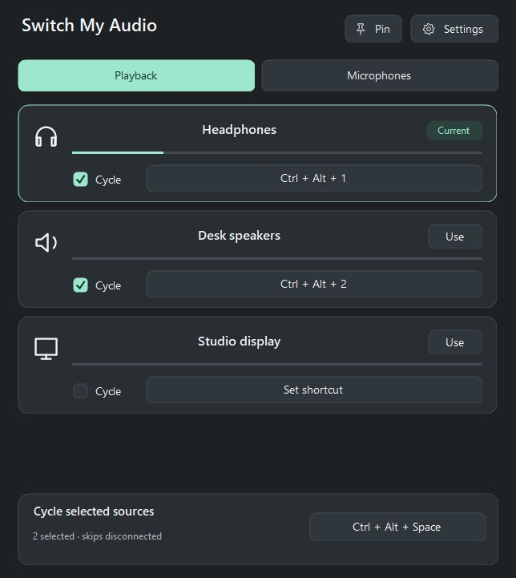
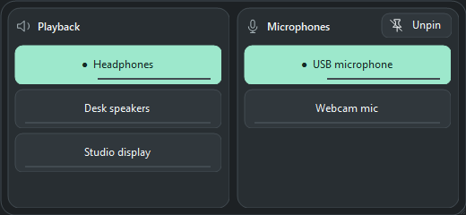

# Switch My Audio

Quickly switch between audio devices and microphones on Windows.

**v0.7.0** · Free & Open Source · Created by [Fuuzan](https://github.com/Fuuzan) · [MIT License](LICENSE)

---

## Screenshots

| Main Window (Dark Mode) | Pinned Mini-Window |
| :---: | :---: |
|  |  |

---

## Get Started

1. **Download:** Get `Setup.exe` from the [Releases](https://github.com/Fuuzan/SwitchMyAudio/releases) page, open it, click **Install**, and then **Open app**.
2. **Launch Later:** Search for **Switch My Audio** in your Windows Start menu, or find its icon in the system tray near the clock (check the hidden `^` arrow if needed).

* **Portable Version:** Extract all files from `portable.zip` into a single folder and run `SwitchMyAudio.exe`.
* **System Requirements:** Windows 10 or 11 (Intel/AMD) and .NET Framework 4.8+.
* **SmartScreen Notice:** Downloads are unsigned, so Windows may show "Windows protected your PC". Check the project's SHA-256 checksums and continue only if you trust the download.

---

## How to Use

* **Switch Devices:** Open the **Playback** or **Microphones** tab and click **Use** next to any device.
* **Global Hotkeys:** Click **Set shortcut** and press any key combination to switch instantly from anywhere. Click the field again and choose **Clear shortcut** to remove it.
* **Cycle Devices:** Check **Cycle** on two or more devices in a tab, then assign a hotkey next to **Cycle selected sources** to toggle through them sequentially.
* **Rename Devices:** Hover over any device name and click **Rename** (`Enter` to save, `Esc` to cancel).
* **Compact Pin Mode:** Click **Pin** for a small, always-on-top window. Drag to move or resize it. Click **Unpin** (or press `Esc`) to restore.
* **Reorder & Hide:** Go to **Settings → Devices** to drag or arrow-key reorder your devices (which also sets your cycle order) or toggle them visible/hidden.

---

## Settings

* **Start with Windows:** Launches the app quietly in the background when you sign in.
* **Appearance & Pinning:** Choose a color theme and select which sources stay visible when pinned.
* **Level Meters:** Displays real-time audio activity (100% local; no audio is recorded).
* **Auto-switch Headphones:** Automatically prioritizes newly plugged-in headphones. *(Note: Windows may still switch devices natively on its own, and wireless USB dongles often stay connected even when the headset is turned off).*

---

## Closing, Updating & Privacy

* **Minimizing to Tray:** Closing the main window keeps the app running in the system tray so your hotkeys stay active. 
* **Quitting:** Right-click the tray icon and select **Quit** to exit completely. Always quit the app before installing an update.
* **Privacy:** Settings are stored locally in `%LOCALAPPDATA%\SwitchMyAudio`. The app works completely offline with zero accounts or telemetry.

---

[Privacy Policy](docs/PRIVACY.md) · [Compatibility](docs/COMPATIBILITY.md) · [Release Notes](docs/RELEASE-NOTES.md)
